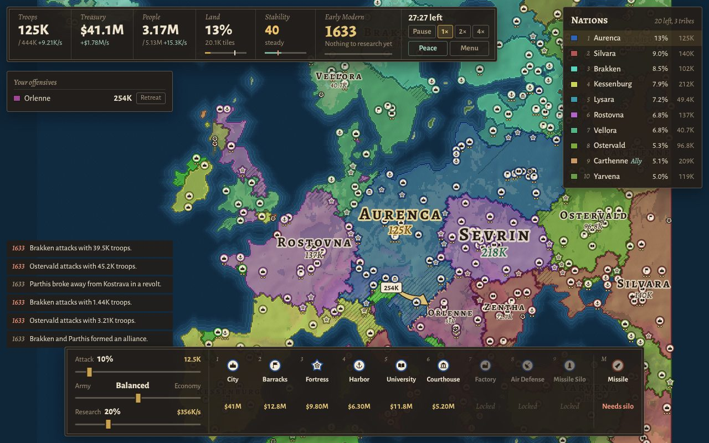

# Borderfall

A real-time world conquest strategy game that runs in your browser. Found a nation in the year 1500, carry it through five centuries of technology, population growth and politics, and hold 70% of the land to win.

## Play

**[▶ Play Borderfall](https://gorzaweba.github.io/Borderfall/)** — https://gorzaweba.github.io/Borderfall/

No install, no account. Works on desktop and mobile browsers.



## Two ways to play

| | Realistic | Blitz |
| --- | --- | --- |
| Calendar | Starts in 1500, one year every 4 seconds | Same calendar, for flavor |
| Technology | Each tech waits for its year and for the techs it builds on | Only needs the techs it builds on |
| Politics | Stability, administration, occupied land, revolts | None |
| Growth | Slower; fronts crawl until railroads and engines | Fast and aggressive |
| Ending | 70% of the land, or the largest nation in the year 2000 | 70% of the land |
| Typical length | 20–35 minutes | 5–10 minutes |

## What you do

- **Expand.** Click land next to your border to send troops into it. Unclaimed land is cheap; enemy land costs troops based on how densely it's held, the terrain, and nearby fortresses.
- **Grow your people.** Population grows toward what your land and cities can feed. Only a share can serve as soldiers (8% in 1500, up to 23% by the World Wars); the rest work and earn gold. Soldiers killed in battle are gone for good.
- **Research.** 28 technologies across six eras, from Military Drill and the Printing Press to Railroads, Machine Guns and Nuclear Fission. Click the year to open the tree and choose what comes next.
- **Keep order (Realistic).** Stability depends on your technology, how far you've outgrown your administration, occupied land, war losses, taxes and levies, and the size of your empire. Conquered land shows hatched until it integrates. Below 30 stability, restless regions break away as new nations. Declare martial law or hold a celebration when things get tense.
- **Build.** Cities, barracks, fortresses, harbors, universities, courthouses, factories, air defense and missile silos. Most unlock through technology.
- **Sail.** Click land across the water and a fleet carries your troops there to open a beachhead.
- **Strike.** Missiles wipe out troops and scorch land for a while. Air defense can shoot them down.
- **Negotiate.** Propose alliances, send gold to win favor, reinforce allies, or betray them at a cost. Nations remember who attacked them and gang up on whoever grows too big.

## Features

- Procedural worlds: Continents, Pangaea, Archipelago and Highlands, in three sizes. Share a seed to replay the same world.
- 3 to 40 AI rivals with distinct personalities (warlords, merchants, guardians, opportunists) and three difficulty levels.
- Six terrain types that change how fast fronts move, how costly land is, and how much it's worth.
- Pause and 1×, 2×, 4× speed.

## Controls

| Input | Action |
| --- | --- |
| Click | Attack, send a fleet, place a building, or fire a missile |
| Right-click / long-press | Options for that spot (build, alliance, gifts, missiles) |
| Drag, mouse wheel, pinch | Move and zoom the map |
| `1`–`9` | Choose a building to place (hold Shift to place several) |
| `T` | Open the technology tree |
| `G` | Open government: stability, administration, policies (Realistic) |
| `M` | Aim a missile |
| `Q` / `E` | Lower or raise the share of troops sent per attack |
| `W` `A` `S` `D` / arrows | Pan the map |
| `Space` | Pause |
| `H` | Jump to your nation |
| `Esc` | Cancel |

## Buildings

| Building | Cost | Unlocked by | What it does |
| --- | --- | --- | --- |
| City | 1,000 | — | Houses 20K people, +10 gold/s, extends administration |
| Barracks | 900 | Military Drill | Recruiting +25%, 0.5% more people can serve |
| Fortress | 700 | — | Land within 9 tiles costs attackers double and falls half as fast |
| Harbor | 900 | — | Coast only. Trade gold from every harbor in the world, +2 fleets |
| University | 1,100 | Printing Press | +4 research per second |
| Courthouse | 1,200 | Bureaucracy | Realistic only. Administers more land and brings it under control |
| Factory | 2,500 | Steam Power | +25 gold/s, recruiting +15% |
| Air Defense | 2,500 | Radar | Shoots down one enemy missile aimed within 22 tiles every 12s |
| Missile Silo | 5,000 | Rocketry | Launches missiles (20s reload) |

Each additional building of the same type costs more.

## Hosting on GitHub Pages

The game is plain HTML, CSS and JavaScript with no build step, so GitHub Pages serves it straight from the repository. One-time setup:

1. Make sure the game files are on the `main` branch.
2. In the repository, open **Settings → Pages**.
3. Under **Build and deployment**, set **Source** to **Deploy from a branch**, pick **`main`** and **`/ (root)`**, then **Save**.
4. After a minute or two the game is live at https://gorzaweba.github.io/Borderfall/. Every push to `main` updates it.

## Run it locally

Open `index.html` in a browser, or serve the folder:

```sh
python3 -m http.server 8000
# then visit http://localhost:8000
```

## Project layout

```
index.html      page structure, menus and HUD
style.css       interface styles
js/util.js      seeded random numbers, noise, colors, formatting
js/mapgen.js    procedural world generation and terrain
js/tech.js      game modes, eras and the technology tree
js/game.js      simulation: territory, combat, population, economy, technology,
                politics, fleets, missiles, diplomacy
js/ai.js        AI nations
js/render.js    canvas map renderer
js/ui.js        menus, HUD, input, tooltips
js/main.js      game loop
```
