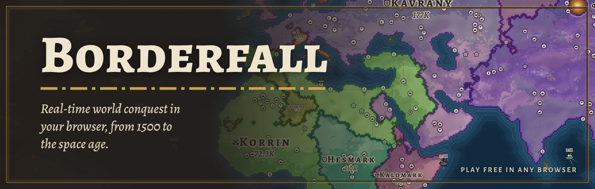
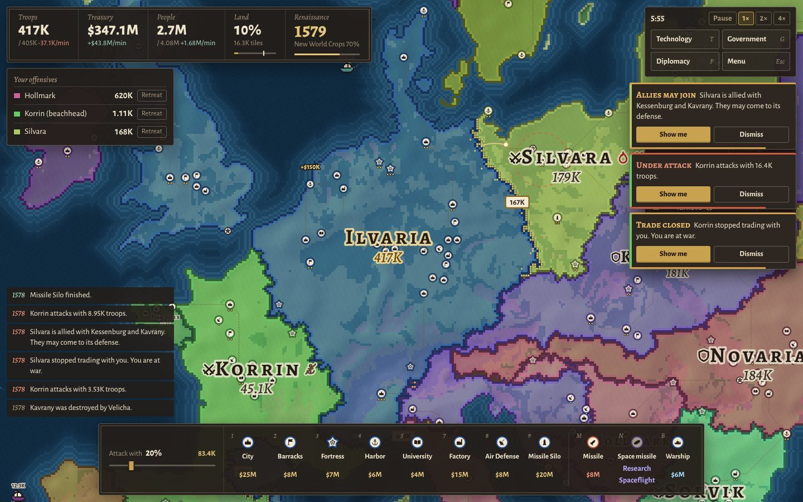
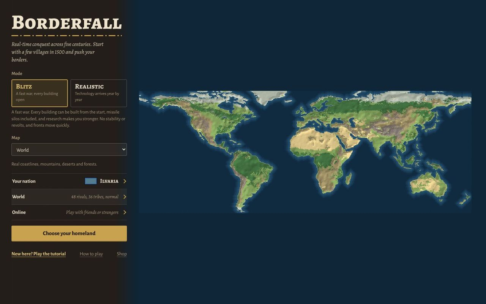
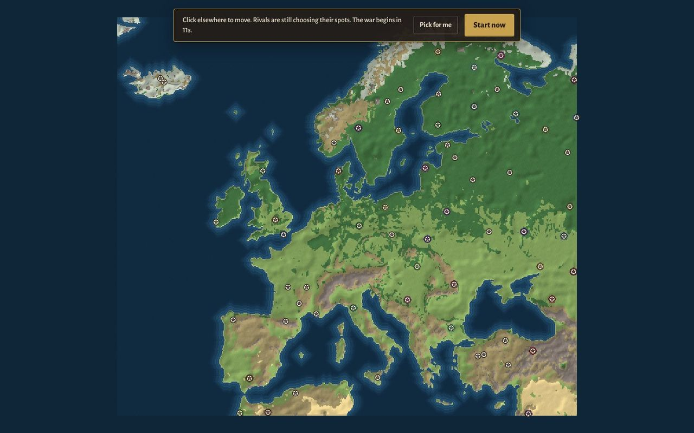
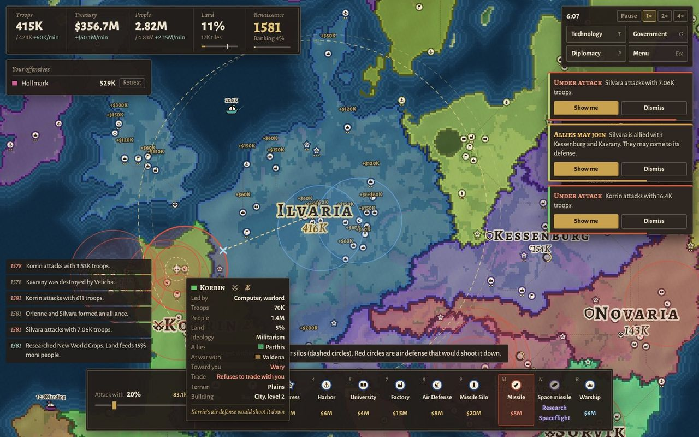
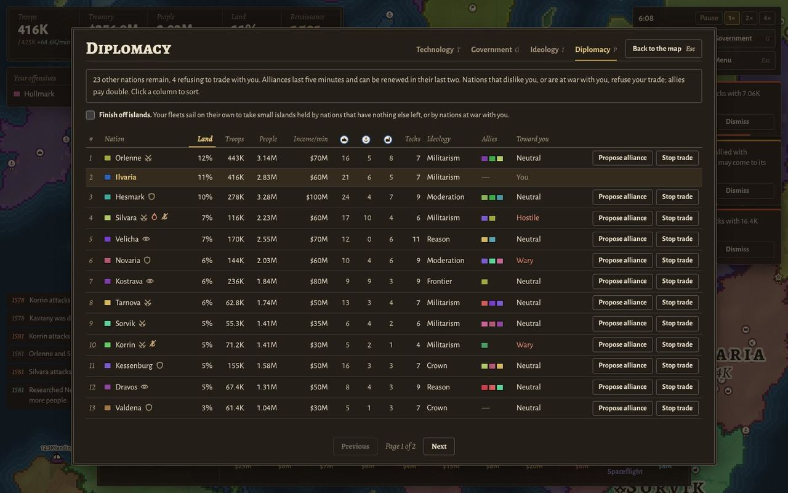
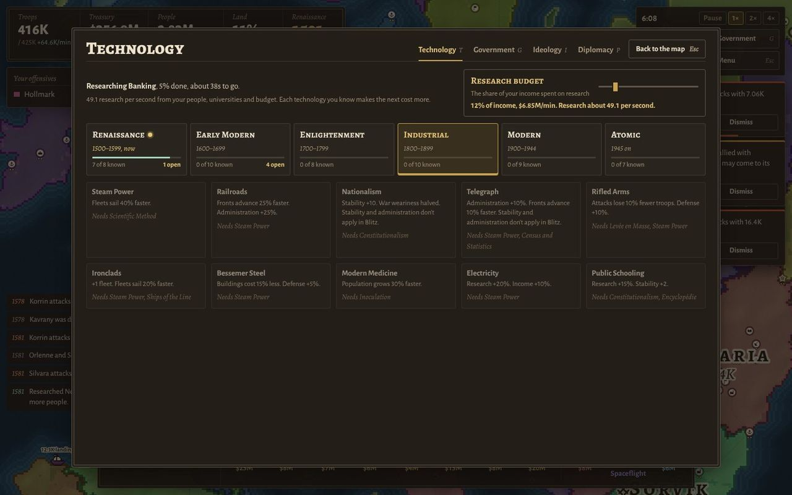
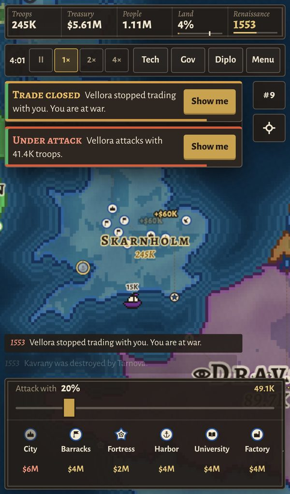

<a name="top"></a>

<p align="center">
  <a href="https://gorzaweba.github.io/Borderfall/"></a>
</p>

<p align="center">
  <a href="https://gorzaweba.github.io/Borderfall/"></a>
  
  
  
  
</p>

<p align="center">
  <a href="#play"><b>Play</b></a> ·
  <a href="#gallery"><b>Gallery</b></a> ·
  <a href="#modes"><b>Modes</b></a> ·
  <a href="#maps"><b>Maps</b></a> ·
  <a href="#how-to-play"><b>How to play</b></a> ·
  <a href="#multiplayer"><b>Multiplayer</b></a> ·
  <a href="#controls"><b>Controls</b></a> ·
  <a href="#buildings"><b>Buildings</b></a> ·
  <a href="#developers"><b>Developers</b></a>
</p>

<br>

<a name="play"></a>

**Borderfall** is a real-time world conquest strategy game that runs in your browser, alone or with friends. Found a nation in the year 1500, carry it through the centuries with technology, population growth and politics, and hold **70% of the land** to win.

> [!TIP]
> **[▶ Play now at gorzaweba.github.io/Borderfall](https://gorzaweba.github.io/Borderfall/)**: no install and no account needed. On your first visit the game offers a two-part tutorial: a three-minute lesson on the controls on a small practice island, then a guided game in which an advisor sets objectives through most of a real match. Neither can be won by conquest; each ends with a closing screen when its last step is done, and you can play on in the guided game's world as an ordinary match.

<p align="center">
  <a href="https://gorzaweba.github.io/Borderfall/"></a>
</p>

<table>
  <tr>
    <td align="center">🗺️<br><b>Real maps &amp; random worlds</b><br><sub>The world, Europe, the Americas and more, or a new world every game</sub></td>
    <td align="center">⚔️<br><b>Fronts in real time</b><br><sub>Send troops, encircle, land fleets and finish rivals off</sub></td>
    <td align="center">🏛️<br><b>Five centuries of progress</b><br><sub>52 technologies, ideologies, stability and revolts</sub></td>
    <td align="center">🚀<br><b>Missiles &amp; warships</b><br><sub>Air defense, space missiles and navies that guard your coast</sub></td>
  </tr>
  <tr>
    <td align="center">🤝<br><b>Diplomacy &amp; trade</b><br><sub>Alliances, gifts, trade bans and rail lines across borders</sub></td>
    <td align="center">🌐<br><b>Multiplayer</b><br><sub>Lobbies, quick match and open games for up to 8 people</sub></td>
    <td align="center">📱<br><b>Plays on phones</b><br><sub>Touch controls, a compact HUD and install to home screen</sub></td>
    <td align="center">🎨<br><b>Heraldic patterns</b><br><sub>Earn crowns and dress your land in Chequy, Tartan or Ermine</sub></td>
  </tr>
</table>

<a name="gallery"></a>

## 🖼️ Gallery

<table>
  <tr>
    <td width="50%"><br><sub><b>The start screen.</b> Pick a mode and a map, set up your nation, and play alone or online.</sub></td>
    <td width="50%"><br><sub><b>Pick your spot.</b> A 15-second countdown: move your nation as often as you like while rivals shift theirs.</sub></td>
  </tr>
  <tr>
    <td width="50%"><br><sub><b>Aim a missile.</b> Red circles are air defense that would shoot it down, blue ones guard you and your allies.</sub></td>
    <td width="50%"><br><sub><b>Diplomacy.</b> Every nation ranked by land, troops, people, income, buildings and research, with alliances, trade and the island toggle.</sub></td>
  </tr>
  <tr>
    <td width="50%"><br><sub><b>Technology.</b> Six eras, one at a time; set a research budget and choose what comes next.</sub></td>
    <td width="50%" align="center"><br><sub><b>On a phone.</b> A slim HUD, touch controls and full screen.</sub></td>
  </tr>
</table>

<a name="modes"></a>

## 🎮 Two ways to play

| | ⚡ Blitz (default) | 📜 Realistic |
| --- | --- | --- |
| **Calendar** | From 1500, one year every 4.5 seconds | Same |
| **Buildings** | All open from the start, missile silos included | Each unlocks through technology |
| **Technology** | Only needs the techs it builds on; makes you stronger | Each tech waits for its year and for the techs it builds on |
| **Politics** | None | Stability, administration, occupied land, revolts |
| **Growth** | Fast; fronts move quickly | Slower; fronts crawl until railroads and engines |
| **Ending** | 70% of the land; no time limit (the clock counts up) | Same |

<a name="maps"></a>

## 🗺️ Maps

- **Random worlds:** Continents, Pangaea, Archipelago and Highlands, in four sizes up to Huge (576,000 tiles, with 66 rival nations and 48 tribes by default). Pick **Random** for a new world every game; the seed decides the world, so you can share one.
- **Real world:** World, Europe, Africa, The Americas, North America, South America, Oceania and Cyprus. These use real coastlines, with mountains, deserts, forests and tundra where they really are.
- **Competitive:** maps built from mirrored or rotated copies of one region, so every start has an identical twin.
  - **Mirror Strait:** two continents facing each other across a strait.
  - **Four Kingdoms:** four realms in two pairs around a contested island.
  - **Ring Sea:** six matching sectors around an inner sea.
  - **Twin Continents:** north and south joined by one mountainous isthmus.

<a name="how-to-play"></a>

## ⚔️ How to play

### 🏁 Found your nation

- **Place.** Each game opens with a 15-second placement countdown. Click to found your nation and click again to move it; rival nations shift their starting spots too, until they settle for the last few seconds. The war begins when the countdown ends (or press **Start now**). In multiplayer, a few seconds remain once every player has picked.
- **Find a nation.** Click a nation in the list at the right, or its row in Diplomacy, to see it on the map.

### 🗡️ Conquer

- **Expand.** Click land to send troops into it (20% of your troops by default). If sending leaves fewer than 15% of your troop limit at home, the troops figure turns red and a warning says so: troops regrow fastest at about 40% of the limit. Settling empty land is steady and cheap, and your border grows toward the spot you click. Dotted lines along the border show every front where you're attacking (brass) or being attacked (red), with the troops fighting there on a tag.
- **Encircle.** Completely surround a patch of land and it becomes yours, unless it belongs to an ally.
- **Finish them off.** A nation or tribe beaten down to a small remnant of its former size surrenders: whoever has been taking its land annexes the rest, with its treasury. No hunting down the last few pixels. The same rule applies to you.
- **Absorb tribes.** Weak grey tribes hold scattered land at the start and keep settling the wilds around them, but rarely attack anyone; their troops and treasure show under their name. They never build or research and their war bands stay small however far they spread, so they're easy pickings, and whoever absorbs one takes its stores. Enemy land costs troops based on how densely it's held, the terrain, and nearby fortresses.

### 🏗️ Build and grow

- **Grow your people.** Population grows toward what your land and cities can feed. Only a share can serve as soldiers (8% in 1500, up to 23% by the World Wars); the rest work and pay taxes. Soldiers killed in battle are gone for good.
- **Manage your treasury.** Money comes in dollars at a realistic scale: you start with $1.2 million, a city costs $2 million and earns about $600K a minute, and a missile costs $8 million. Most income is your workers' taxes, so your population is your economy. Your cities, harbors and factories show what they earn above them as it arrives. In Government, set your national priority: lean toward the army and troops refill faster, toward the economy and money comes in faster.
- **Build and stack.** Cities, barracks, fortresses, harbors, universities, courthouses, factories, air defense and missile silos, from the bottom bar or by right-clicking your land, where each comes with its icon and price. In Blitz every building is open from the start; in Realistic most unlock through technology. New buildings take time to go up (a city ten seconds), and you can demolish one for a quarter of its price. Build on top of one of your own buildings of the same type to stack it up to level 5, at once; every level adds its full effect again. A harbor placed inland goes to your nearest coast, and the preview shows where. Roads join your capital, cities, factories and harbors, and turn into railways once you know Railroads.

### 🔬 Rule

- **Research.** Set a research budget at the top of the Technology screen: the share of your income spent on research. 52 technologies across six eras, from Military Drill and Craft Guilds to Railroads, the Telegraph, Machine Guns, Nuclear Fission and Spaceflight, shown one era at a time with your progress through each. Click the year to open it and choose what comes next.
- **Choose an ideology.** Every nation starts with Moderation, the balanced one. On the Ideology screen (<kbd>I</kbd>) switch to Crown, Commerce, Militarism, Reason or Frontier, each with strengths and weaknesses; the first change is free. Each ideology has a tree of six doctrines bought with money: the first opens two branches and the last needs both.
- **Keep order (Realistic).** Stability depends on your technology, how far you've outgrown your administration, occupied land, war losses, taxes and levies, troops kept at home, whether your people have room to grow, and the size of your empire. Victories count in your favor: land, capitals and nations taken in war lift stability for a while, so a war you're winning steadies the country. Conquered land shows hatched until it integrates. Every building settles the land around it, so building in a restless region calms it. When a revolt is brewing the map marks where and warns you; below 30 stability that region breaks away, with an alert that shows you where. Declare martial law, lower taxes or hold a celebration when things get tense.

### ⚓ At sea

- **Sail.** Click land across the water, or right-click near any coast and choose Send fleet. Fleets sail about two tiles a second at first (faster with naval technology), ride at anchor briefly, then put their troops ashore. War fleets fly their nation's colours and leave a wake; the small brown ships are merchants trading between harbors. You can have 2 fleets at sea, one more per harbor level, up to 8.
- **Warships** (<kbd>B</kbd>, or right-click the sea). Bought at a harbor ($6M, more for each one afloat), a warship sails to the spot you pick and stands guard. It sinks troop fleets sailing to land on you or your allies, and fights the fleets and warships of nations at war with you. One warship per harbor level, up to 6; right-click the sea to move the nearest one. Missiles sink warships too.
- **Finish off islands.** In Diplomacy, tick *Finish off islands* and your fleets sail on their own, with enough troops, to take small islands held by nations that have nothing else left, or by nations at war with you.

### 🚀 Missiles and air defense

- **Strike.** Missiles wipe out troops and scorch land for a while; the screen shakes when one hits you.
- **Range and reloads.** A silo holds one missile per level, reloads them one at a time, and reaches 90 tiles (45 more per level). Air defense shoots down missiles flying at its owner or its owner's allies anywhere inside its circle (22 tiles, 5 more per level), with one shot per level.
- **See the defenses.** While you aim a missile or place a silo, the map shows every air defense (red if it would shoot at you, blue for yours and your allies'), your silos' reach, and where along its course a missile would be shot down.
- **Space missiles** (<kbd>N</kbd>). Once you research Spaceflight, a silo of level 2 or more also fires space missiles: three times the price, unlimited range, and out of reach of air defense while in space, so only defenses near the launch or the landing can stop one.

### 🤝 Diplomacy and trade

- **Negotiate.** Propose alliances, send money to win favor, reinforce allies, or betray them at a cost. Alliances last five minutes and can be renewed in their last two. Icons beside each name show who is allied with you, who is hostile, and who you don't trade with. Hover a nation, or open Diplomacy, to see who it is allied with and who it is at war with: attack a nation and its allies resent it and may come to its defense, and you're warned when that might happen. Diplomacy ranks every nation by land, troops, people, income, buildings and research. Nations remember who attacked them and gang up on whoever grows too big, but they don't pile onto a player already fighting someone else, and nations that feel warm toward you don't land troops on you.
- **Trade.** Harbors earn from the harbor of every nation that trades with you. Neighbours that both have a city, factory or harbor are joined by a road or railway across the border, which pays both sides (up to six neighbours). Allies pay double, by sea and across the border. Nations that dislike you or are at war with you refuse your trade, and you can stop trading with any nation yourself: right-click it and choose *Stop trading*, or use Diplomacy. Trade then stops both ways, and they resent it.

<a name="multiplayer"></a>

## 🌐 Multiplayer

- **Create lobby** gives you a 5-letter code and an invite link to share. Friends join with the code or by opening the link.
- **Quick match** joins an open public game in the same mode, or opens one that starts automatically 40 seconds after someone joins.
- **Open games** (with online services) lists public matches and lobbies whose host ticked *Show in open games*, with their mode, map and player count. Join one with a click.
- Up to 8 people per match, with computer nations filling the world. The host picks the mode, map, rivals and difficulty, and everyone sees the changes live.

Players connect directly to each other (WebRTC), so there is no game server to run. To find each other they use the game's Firebase Realtime Database when online services are set up (joining takes under a second), or public Nostr relays otherwise. The host's browser runs the match: if the host leaves, the match ends; if anyone else drops out, the computer takes over their nation.

> [!NOTE]
> Some strict networks (certain office, school or mobile networks) block direct connections. If joining fails, try another network.

## 🏆 Accounts and leaderboard

With online services set up (see [Setting up Firebase](#firebase)), the start screen has an **Account** row:

- Everyone starts as a **guest**. Crowns, patterns, tutorial progress and results are saved online for that browser.
- **Sign in with Google** to keep them on every device. A guest's progress joins the account; if the account already has a save from another device, the two are merged so nothing is lost or counted twice.
- **Sign out** leaves everything with the account and turns the browser back into a new guest.

Every finished game, and any game left after three minutes, earns **leaderboard points**: one for each 1% of the world you held at your peak, four for each nation or tribe you destroy, and 100 for a win. Points are halved on Easy and raised by half on Hard; worlds with fewer than 20 rivals count for less, and you get a quarter more when other players are in the match. Tutorials don't count. The **Leaderboard** ranks players by best game, total points and wins, under the name and colour of the nation they last played.

Without online services, all of this is hidden and progress stays in the browser.

## 🎨 Shop

Give your nation's land a pattern: 13 heraldic designs, from Barry (bands) and Chequy (checks) to Lozengy, Masoned brickwork, Tartan, Semé of stars and Ermine. They are drawn into the map tile by tile, and other players see yours in multiplayer.

Patterns cost **crowns**, which you earn by playing: one for each 1% of the world you held at your peak, three for each nation or tribe you destroy, up to ten for time played, and a bonus for winning. You start with 100, and the two tutorials pay 50 and 100 the first time. Open the shop from the link under the start button, or from Your nation. Crowns are saved in your browser, and to your account when online services are set up; no real money is involved.

## ✨ Features

- 🤖 3 to 90 AI rivals and up to 60 tribes (30 nations and 24 tribes by default on a medium world; each map and size suggests its own) with distinct personalities, each tagged with an icon beside its name: crossed swords for warlords, scales for merchants, a shield for guardians and an eye for opportunists. Three difficulty levels.
- 🏔️ Six terrain types that change how fast fronts move, how costly land is, and how much it's worth.
- 🎓 A controls lesson and a guided game for your first time.
- 🪟 Every screen fits the window without scrolling: Technology, Government, Ideology and Diplomacy are tabs of one frame, How to play is split into pages, and the start screen's options open in cards beside it.
- 🔔 Alert cards for what matters: attacks on you, incoming fleets and missiles, revolts and unrest, a lost capital, alliances accepted, declined, ending, expired or broken, a target's allies who may join its defense, nations that stop trading with you, and conquests. Each has a button to act on it (show me, renew, propose again, send a gift). Cards and alliance offers sit in the right-hand column, out of the middle of the map, with at most three alerts and two offers at once. Choose all, threats only or none in the menu.
- 👆 Built for touch as well as mouse: tap to act, press and hold for options (with what a tooltip would show), drag and pinch the map, finger-sized buttons, room left for notches, short vibrations for long-press and threats where phones support them, and full screen or install to the home screen like an app. Works in portrait and landscape: on a phone the HUD folds into a slim row of figures and controls, and the nations list opens from your rank.
- 🖥️ High and Low graphics. Low draws at 30 fps and native resolution with simpler effects, for phones and older computers.
- ⏯️ Pause and 1×, 2×, 4× speed in single player.

<a name="controls"></a>

## ⌨️ Controls

| Input | Action |
| --- | --- |
| **Click** | Attack, send a fleet, place a building, or fire a missile |
| **Right-click** / **long-press** | Options for that spot (build, alliance, gifts, trade, missiles, warships) |
| **Drag**, **mouse wheel**, **pinch** | Move and zoom the map |
| <kbd>1</kbd> – <kbd>9</kbd> | Choose a building to place (hold <kbd>Shift</kbd> to place several) |
| <kbd>T</kbd> | Open the technology tree |
| <kbd>P</kbd> | Open diplomacy: a leaderboard of every nation, how each feels about you, alliances and trade |
| <kbd>G</kbd> | Open government: national priority, plus stability, administration and policies (martial law, tax relief, celebrations) in Realistic |
| <kbd>I</kbd> | Open ideology: choose one and buy its doctrines |
| <kbd>M</kbd> | Aim a missile |
| <kbd>N</kbd> | Aim a space missile |
| <kbd>B</kbd> | Send a warship |
| <kbd>Q</kbd> / <kbd>E</kbd> | Lower or raise the share of troops sent per attack |
| <kbd>W</kbd> <kbd>A</kbd> <kbd>S</kbd> <kbd>D</kbd> / arrows | Pan the map |
| <kbd>Space</kbd> | Pause |
| <kbd>H</kbd> | Jump to your nation |
| <kbd>Esc</kbd> | Cancel, or open the menu |

<a name="buildings"></a>

## 🏛️ Buildings

In Blitz every building is open from the start; the technologies below unlock them in Realistic only. Each additional building of the same type costs more.

| | Building | Cost | Unlocked by (Realistic) | What it does |
| :---: | --- | --- | --- | --- |
|  | **City** | $2M | — | Houses 20K people, earns $600K/min, extends administration |
|  | **Barracks** | $1.8M | Military Drill | Recruiting +25%, 0.5% more people can serve |
|  | **Fortress** | $1.4M | — | Land within 9 tiles costs attackers double and falls half as fast |
|  | **Harbor** | $1.8M | — | Goes on the nearest coast. Trade income from the harbors of nations that trade with you (double from allies), +1 fleet (up to 8) and +1 warship (up to 6) |
|  | **University** | $2.2M | Printing Press | +2 research per second |
|  | **Courthouse** | $2.4M | Bureaucracy | Realistic only. Administers more land and brings it under control |
|  | **Factory** | $5M | Steam Power | Earns $1.5M/min, recruiting +15% |
|  | **Air Defense** | $5M | Radar | Shoots down missiles flying at you or your allies within 22 tiles (+5 a level); one shot a level, reloaded one every 12s |
|  | **Missile Silo** | $10M | Rocketry | Launches missiles up to 90 tiles away (+45 a level); one missile a level, reloaded one every 20s; with Spaceflight, level 2 and up launch space missiles |

### Weapons and ships

| | | Cost | What it does |
| :---: | --- | --- | --- |
|  | **Missile** | $8M and up | Wipes out troops and scorches land where it lands; air defense along the way can shoot it down |
|  | **Space missile** | 3× a missile | Needs Spaceflight and a level 2 silo. Reaches anywhere; only air defense near its launch or landing can stop it |
|  | **Warship** | $6M and up | Stands guard at sea, sinks fleets sailing for you or your allies, and fights nations at war with you |

<a name="developers"></a>

## 🛠️ For developers

The game is plain HTML, CSS and JavaScript with no build step.

<details>
<summary><b>🚀 Hosting on GitHub Pages</b></summary>

<br>

GitHub Pages serves the game straight from the repository. One-time setup:

1. Make sure the game files are on the `main` branch.
2. In the repository, open **Settings → Pages**.
3. Under **Build and deployment**, set **Source** to **Deploy from a branch**, pick **`main`** and **`/ (root)`**, then **Save**.
4. After a minute or two the game is live at https://gorzaweba.github.io/Borderfall/. Every push to `main` updates it.

</details>

<a name="firebase"></a>

<details>
<summary><b>🔥 Setting up Firebase</b> (accounts, cloud saves, leaderboard, open games)</summary>

<br>

Accounts, cloud saves, the leaderboard, the open games list and faster multiplayer connections use a Google Firebase project (the free Spark plan is enough to start). In the [Firebase console](https://console.firebase.google.com/):

1. **Create a project**, or open yours.
2. **Build → Realtime Database → Create Database.** Pick a location, and start in *locked mode*.
3. On the database's **Rules** tab, replace everything with the contents of [`database.rules.json`](database.rules.json) and **Publish**. (With the Firebase CLI: `firebase deploy --only database --project <your-project-id>`.)
4. **Build → Authentication → Get started.** Under **Sign-in method**, enable **Anonymous** and **Google**.
5. Under **Authentication → Settings → Authorized domains**, add `gorzaweba.github.io` (and any other domain the game is served from; `localhost` is there already).
6. **Project settings → Your apps → Add app → Web.** Register it (no Firebase Hosting needed), then copy the `firebaseConfig` object.
7. Paste it into [`js/firebase-config.js`](js/firebase-config.js) as `const FIREBASE_CONFIG = { ... };` and push. Make sure it includes `databaseURL`; if not, the database was created after the app, so copy the config again.

The config isn't a secret: every visitor's browser receives it. What players may read and write is decided by the rules: everyone can read the leaderboard; players can read and write only their own save and leaderboard row, with values checked; open lobbies can be changed only by their host.

Things to know:

- The Spark plan allows 100 players connected to the database at once (and 1 GB stored, 10 GB downloaded a month). The game drops its connection during single-player matches to save room. The pay-as-you-go Blaze plan raises the limit to 200,000.
- Results are reported by players' own browsers. The rules stop impossible values, but a determined cheater could still edit their own numbers; stopping that would need a server (Cloud Functions) to verify each game.
- Leaderboard names are nation names the players choose; there is no filter.

</details>

<details>
<summary><b>💻 Run it locally</b></summary>

<br>

Serve the folder and open it in a browser (multiplayer needs a web server; single player also works from `index.html` directly):

```sh
python3 -m http.server 8000
# then visit http://localhost:8000
```

To try multiplayer on one computer without the internet, open two tabs at `http://localhost:8000/?net=local`; they connect through the browser instead of the relays.

To try the online services without a Firebase project, run the Firebase emulators from this folder (needs Node.js and Java) and add `?fb=emu` to the address. Google sign-in then shows the emulator's test accounts. `?fb=off` switches online services off, and `?net=nostr` uses the public relays even when Firebase is set up.

```sh
npx firebase-tools emulators:start --project demo-borderfall
# then visit http://localhost:8000/?fb=emu
```

</details>

<details>
<summary><b>📁 Project layout</b></summary>

<br>

```
index.html      page structure, menus and HUD
style.css       interface styles
js/util.js      seeded random numbers, noise, colors, formatting
js/mapgen.js    procedural world generation and terrain
js/tech.js      game modes, eras and the technology tree
js/game.js      simulation: territory, combat, population, economy, technology,
                politics, fleets, warships, missiles, diplomacy
js/ai.js        AI nations
js/render.js    canvas map renderer
js/ui.js        menus, HUD, input, tooltips
js/net.js       multiplayer: lobbies, quick match, host-run games
js/cloud.js     online services through Firebase: accounts, cloud saves, leaderboard,
                open lobbies, multiplayer signaling
js/firebase-config.js   your Firebase project's web config (null switches online services off)
js/tutorial.js  controls lesson and guided game
js/shop.js      land patterns, crowns and the shop
js/main.js      game loop
vendor/         bundled Trystero peer-to-peer library (MIT), and the Firebase JS SDK with
                Trystero's Firebase signaling (Apache-2.0 and MIT), loaded only when set up
database.rules.json   Realtime Database security rules to publish to the project
firebase.json   Firebase CLI settings: the rules file and the local emulators
maps/*.js       real-world maps, one character per tile, loaded only when picked
manifest.webmanifest, icons/   install to a phone's home screen (opens full screen)
docs/           the README's banner, screenshots and building icons
```

</details>

## 🌍 Map data

The real-world maps were generated from public-domain sources:

- **Coastlines:** [Natural Earth](https://www.naturalearthdata.com/), via the [world-atlas](https://github.com/topojson/world-atlas) package
- **Elevation:** NOAA ETOPO1 global relief
- **Land cover:** NASA Blue Marble imagery

The ETOPO1 and Blue Marble images come from the [basemap-data](https://pypi.org/project/basemap-data/) package. The Kyrenia range on the Cyprus map was added by hand, because it's too narrow for the source data.

<br>

<p align="center">
  <a href="https://gorzaweba.github.io/Borderfall/"></a>
  <br><br>
  <a href="#top">Back to top ↑</a>
</p>
